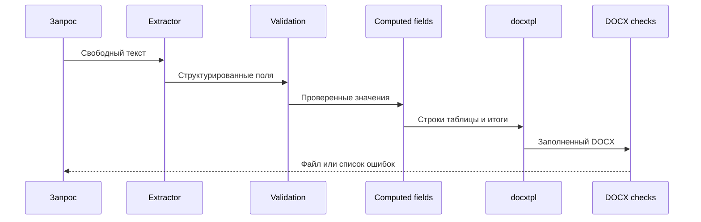

# AI Legal Docs

Целевой продукт состоит из трёх модулей: общий правовой MCP для ChatGPT/Claude,
юридический плагин для Codex/Claude Code и IDE с подключаемыми модулями.
MCP и плагин должны быть полезны независимо. [Концепция](docs/specs/modular-legal-platform.md)
и [порядок разработки](docs/plans/active/modular-platform-roadmap.md) обновлены 30.10.2026.
Самостоятельные модули пока не выпущены.

Сейчас реализован небольшой конвейер, который извлекает поля из запроса и заполняет готовый DOCX шаблон.
В репозитории есть только вымышленный договор оказания услуг. Реальные документы и данные не
используются.

Также есть [рабочий AI-прототип юридической IDE](docs/runbooks/live-ide.md):
`uv run python scripts/run_ide.py` → `http://127.0.0.1:8765`.
Чат с выбранным API, контекст синтетического договора, просмотр запроса, предложения правок
и отдельный вызов проверяющего. Настоящие Word/PDF-движки и правовая база еще не подключены.
Открытие `prototypes/legal-ide/index.html` напрямую сохраняет автономный макет без сети.
Результаты проверки источника права:
[технический аудит pravo.gov.ru](docs/investigations/pravo-portal-audit.md).

> **Юридический дисклеймер**
>
> Проект не оказывает юридическую консультацию. Демонстрационный текст не является договором и
> не подходит для реальной сделки без проверки квалифицированным юристом.

## Что показывает проект

1. Извлечение структурированных значений через небольшой интерфейс `Extractor`.
2. Проверку обязательных полей до создания файла.
3. Заполнение обычных и списочных слотов через `docxtpl`.
4. Расчёт сумм по строкам, общего итога и суммы прописью обычным кодом.
5. Проверку готового DOCX на незаполненные слоты и маркер `SYNTHETIC DEMO`.

В исходном DOCX-конвейере LLM только извлекает данные. Правовой текст хранится в
проверяемом шаблоне, а расчёты выполняются детерминированно.
Отдельный IDE-прототип допускает предложения модели к тексту синтетического примера;
они проходят структурную проверку и применяются только пользователем.

## Как устроен конвейер



Подробности есть в [описании архитектуры](docs/architecture.md).

## Работа над проектом

Правила разработки и работы агентов находятся в [AGENTS.md](AGENTS.md); Claude Code начинает
с [CLAUDE.md](CLAUDE.md). [Карта документации](docs/INDEX.md) ведёт к требованиям, планам
и процедурам, а [текущее состояние](docs/CURRENT_STATE.md) позволяет продолжить работу
в новой сессии. Команды и выбор проверок описаны в [runbook](docs/runbooks/development.md).

## Быстрый старт

Нужны Python 3.11 или новее и [uv](https://docs.astral.sh/uv/).

```bash
uv sync --locked --dev
uv run python scripts/run_demo.py
uv run pytest
```

Результат появится в `out/synthetic-service-agreement.docx`. Папка `out` не попадает в Git.
Для демо не нужны Telegram token и LLM key. Скрипт использует `MockExtractor` и значения из
`examples/expected-fields.json`.

## Синтетический пример

В примере участвуют ООО «Пример» и Иван Иванов. Адреса используют документационные названия,
а идентификаторы начинаются с `TEST-INN`. Они намеренно не похожи на рабочие реквизиты.

Исходный запрос находится в `examples/request.txt`. Схема полей находится в
`templates/synthetic-service-agreement/fields.yaml`. Шаблон помечен как `SYNTHETIC DEMO`.

## Подключение LLM

Реализуйте интерфейс `TextCompletion` с методом `complete(prompt) -> str` и передайте его в
`JsonLLMExtractor`. SDK и конкретный провайдер не зашиты в ядро. Ключи приходят через
переменные окружения и не сохраняются в коде или логах.

## Ограничения

- Это демонстрация архитектуры, а не сервис для реальных документов.
- Поля и формат денег рассчитаны только на один синтетический сценарий.
- Использование извлечённых значений в реальном процессе требует отдельной проверки.
- Шаблон не обновляется автоматически при изменении законодательства.

Подробнее в [ограничениях](docs/limitations.md) и [описании обработки данных](SECURITY.md).

## Происхождение материалов

Шаблон создан с нуля. Код движка вручную перенесён и упрощён из закрытого проекта владельца
репозитория. Детали и условия публикации описаны в [PROVENANCE.md](PROVENANCE.md).

## Лицензия

Код и синтетический шаблон доступны по MIT License. Лицензии зависимостей остаются у их авторов.
