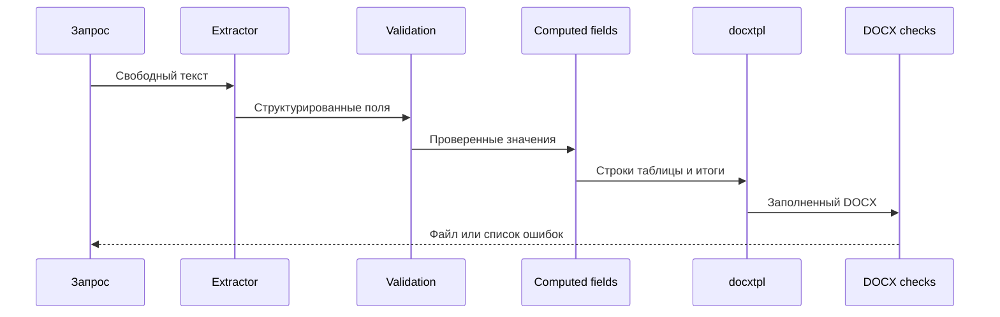

# AI Legal Docs

Небольшой пример конвейера, который извлекает поля из запроса и заполняет готовый DOCX шаблон.
В репозитории есть только вымышленный договор оказания услуг. Реальные документы и данные не
используются.

> **Юридический дисклеймер**
>
> Проект не оказывает юридическую консультацию. Демонстрационный текст не является договором и
> не подходит для реальной сделки без проверки квалифицированным юристом.

## Что показывает проект

1. Извлечение структурированных значений через небольшой интерфейс `Extractor`.
2. Проверку обязательных полей до создания файла.
3. Заполнение обычных и списочных слотов через `docxtpl`.
4. Расчёт сумм по строкам, общего итога и суммы прописью обычным кодом.
5. Проверку готового DOCX на незаполненные слоты и маркер `SYNTHETIC DEMO`.

LLM здесь только извлекает данные. Он не пишет условия договора. Правовой текст хранится в
проверяемом шаблоне, а расчёты выполняются детерминированно.

## Как устроен конвейер



Подробности есть в [описании архитектуры](docs/architecture.md).

## Быстрый старт

Нужны Python 3.11 или новее и [uv](https://docs.astral.sh/uv/).

```bash
uv sync --locked --dev
uv run python scripts/run_demo.py
uv run pytest
```

Результат появится в `out/synthetic-service-agreement.docx`. Папка `out` не попадает в Git.
Для демо не нужны Telegram token и LLM key. Скрипт использует `MockExtractor` и значения из
`examples/expected-fields.json`.

## Синтетический пример

В примере участвуют ООО «Пример» и Иван Иванов. Адреса используют документационные названия,
а идентификаторы начинаются с `TEST-INN`. Они намеренно не похожи на рабочие реквизиты.

Исходный запрос находится в `examples/request.txt`. Схема полей находится в
`templates/synthetic-service-agreement/fields.yaml`. Шаблон помечен как `SYNTHETIC DEMO`.

## Подключение LLM

Реализуйте интерфейс `TextCompletion` с методом `complete(prompt) -> str` и передайте его в
`JsonLLMExtractor`. SDK и конкретный провайдер не зашиты в ядро. Ключи приходят через
переменные окружения и не сохраняются в коде или логах.

## Ограничения

- Это демонстрация архитектуры, а не сервис для реальных документов.
- Поля и формат денег рассчитаны только на один синтетический сценарий.
- Использование извлечённых значений в реальном процессе требует отдельной проверки.
- Шаблон не обновляется автоматически при изменении законодательства.

Подробнее в [ограничениях](docs/limitations.md) и [описании обработки данных](SECURITY.md).

## Происхождение материалов

Шаблон создан с нуля. Код движка вручную перенесён и упрощён из закрытого проекта владельца
репозитория. Детали и условия публикации описаны в [PROVENANCE.md](PROVENANCE.md).

## Лицензия

Код и синтетический шаблон доступны по MIT License. Лицензии зависимостей остаются у их авторов.
