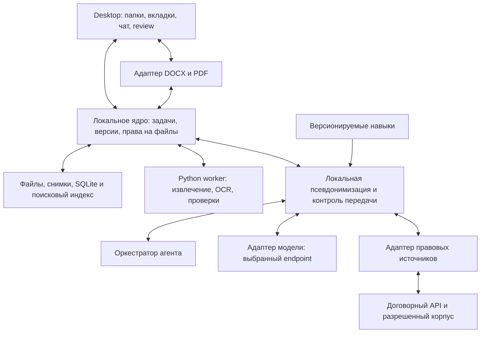

# Видение универсальной юридической IDE для Windows

Обновлено: 2026-10-19. Статус: направление подтверждено владельцем; реализация и поставщики не выбраны.
Основание: [рыночное и техническое исследование](../investigations/legal-ide-market.md).

## Подтвержденное направление

Коммерческий продукт: универсальная юридическая IDE для Windows с локальными папками.
Работа начинается с цели и обстоятельств клиента, документы могут добавляться позднее.
IT и участие поставщика в закупках по 44-ФЗ/223-ФЗ — первые профили и корпус проверки,
а не предел возможностей продукта. Основная юрисдикция проектирования — РФ.

Обязательные части ядра по запросу владельца: RAG, быстрый конструктор навыков, встроенный
доступ агента к законодательной базе с первой продуктовой версии, собственный API модели,
Word/PDF и проверяемые изменения. Внешний агент получает только псевдонимизированные данные;
таблица соответствий и обратная подстановка остаются на компьютере пользователя.
Объем прямого редактирования PDF, модель, поставщик контента, бюджет и команда еще открыты.

## Продуктовая задача

Юрист описывает задачу клиента. Агент собирает факты и неизвестное, определяет правовые вопросы,
исследует источники, предлагает варианты действий и готовит/редактирует документы.
Общие юридические понятия и рассуждение обеспечивает модель; актуальность норм и доказательства —
источники и RAG; процедуру и стандарты работы — навыки. Не нужно обучать собственную модель
на «всём праве», чтобы начать, или заранее ограничивать вход выбранным типом договора.

Первый проверочный сценарий: IT-поставщик открывает пакет закупки → агент собирает требования
и противоречия со ссылками на документы → юрист оценивает участие → получает проект вопросов,
замечаний или документов. Режим закупки и допустимость конкретных действий проверяются по
актуальным источникам: нельзя автоматически считать любой проект контракта свободно изменяемым.
Второй профиль: IT-договоры — предмет, лицензирование/права, приемка, SLA, данные и ответственность.
Это предлагаемые чек-листы, не готовые юридические заключения.

Ценность следует измерять временем до пригодной версии и качеством замечаний. Количество
сообщений агенту и объем сгенерированного текста не являются мерой полезности.

## Рабочее пространство

| Область | Содержимое |
| --- | --- |
| Слева | Выбранная локальная папка, подпапки, договоры/приложения, поиск, статус индексирования |
| Центр | Вкладки DOCX/PDF/правовых актов; документ с привычной версткой, review и сравнением |
| Справа | Чат по делу, выбранные источники контекста, ход задачи, предложенные правки |
| Панель основания | Для выделенного пункта: риск, позиция компании, норма/практика, редакция и цитата |

От Cursor переносим работу с контекстом папки, выделением и проверяемыми изменениями.
Механизм checkpoints полезен как референс возврата к состоянию до работы агента.
[Cursor checkpoints](https://cursor.com/docs/agent/overview).
При этом юристу нужны номера пунктов, redline и версии договора; Git и терминал не обязательны
в пользовательском интерфейсе. Не требуется форкать VS Code ради сходства расположения панелей.

## Обязательное ядро и первый пилот

1. Открыть разрешенную папку; увидеть файлы, поиск и состояние обработки. Оригиналы остаются
   на месте, изменения/версии сохраняются прозрачно для пользователя.
2. Открыть и вручную редактировать DOCX внутри приложения с комментариями и tracked changes.
   Поддержанный набор структур определяется корпусом испытаний, а не обещанием «любой Word».
3. Читать PDF, выделять и комментировать фрагменты; искать по тексту/OCR и ссылаться на страницу.
   Прямая правка исходного PDF — отдельная ветка выбора, описанная ниже.
4. Подключить endpoint, модель и ключ. Проверить соединение и реальные возможности провайдера.
5. Задать агенту задачу по ситуации клиента, с документами или без; получить план, источники и правки
   с объяснением, принять/отклонить по одной или группой, отменить результат.
6. Загрузить стандарт компании: обязательные условия, предпочтительная редакция, допустимые
   уступки и условия эскалации. Отмечать его как внутреннюю позицию, не законодательство.
7. Поиск нормы по номеру/названию/смыслу; открытие фрагмента и редакции в соседней вкладке,
   когда это позволяет источник. Внешняя ссылка — явно ограниченный fallback, не замена
   требованию встроенного просмотра. Полнота поиска зависит от подключенного комплекта.
8. Сохранить redline и чистый DOCX, историю операций и аннотации; восстановиться после перезапуска.
9. Использовать RAG по правовым источникам, материалам дела и стандартам компании с раздельным
   происхождением и правами доступа. [Контракт RAG и навыков](agent-knowledge-skills.md).
10. Создать навык из инструкции, образца или успешной работы; проверить на примерах,
    сохранить версию и повторно использовать. Навык не получает новые права автоматически.
11. До каждого доступа модели применять локальную псевдонимизацию и проверку каналов передачи;
    восстановить значения только для локального просмотра и применения правок.
    [Требования](local-pseudonymization.md).

Первый пилот можно ограничить одним редактируемым документом и несколькими документами
контекста. Сквозные правки договора, приложения и протокола разногласий — следующий этап.
Это предлагаемый способ снизить риск первого релиза, а не снятие долгосрочного требования.

Пока не включать: CLM целиком, согласования всей компании, ЭДО/подпись, подачу в суд,
автономную отправку контрагенту, полную базу всех юрисдикций, совместное редактирование
в реальном времени и гарантированную обработку любых DOC/DOCM/защищенных файлов.
Старый бинарный `.doc` при необходимости требует явного импорта/конвертации.

## Решение по PDF

Вариант A для раннего пилота: просмотр, OCR, поиск, аннотации; глубокая переработка создает
новый DOCX из извлеченного текста с новой версткой. Конвертация с попыткой сохранения исходного
оформления требует отдельного конвертера, проверки и оценки стоимости; viewer/OCR ее не обеспечивают.
Это не нативное редактирование существующего содержимого PDF, и так продукт
должен это обозначать. Преимущество — раньше проверить ценность договорного workflow.

Вариант B: встроенный PDF SDK с изменением существующего текста/изображений и операций
со страницами; агент вызывает его программные операции. Прямые правки сохраняются новой
PDF-версией с собственным журналом и сравнением, без обещания Word Track Changes внутри PDF.
Скан и PDF с текстовым слоем проходят разные маршруты. OCR сам по себе не делает скан
полноценным редактируемым Word; неподдержанный случай должен быть виден до изменения.

Моя рекомендация: испытать B в техническом spike, но первый коммерческий объем выбрать
после проверки частоты этой задачи у юристов. Если она обязательна в первом релизе,
заложить SDK и ее приемку сразу; не подменять ее аннотациями. Сравнение затрат и источники —
в [исследовании](../investigations/legal-ide-market.md).

## Рекомендуемая архитектура

Основной вариант — Electron + React/TypeScript, локальное хранилище и набор изолированных
адаптеров для документов, моделей и правовых источников. Это предложение под выбранный desktop,
а не уже принятый стек. Tauri остается альтернативой при приоритете размера приложения и опыте
Rust; выбирать две оболочки одновременно не нужно.

Предлагаемое распределение:

- React — интерфейс и встраивание редактора; Electron main — ограниченный доступ к выбранным
  папкам, системному хранилищу ключей и запуску локальных процессов.
- Локальное ядро на TypeScript — версии, очередь задач, адаптеры редактора и агентный цикл.
  Python оставить для существующего демо, извлечения/OCR и подходящих библиотек; не оборачивать
  каждую операцию UI в Python-сервис. Межпроцессный контракт должен быть небольшим и версионированным.
- SQLite — метаданные дел/документов/операций/аннотаций; файлы и неизменяемые снимки — на диске.
  Локальный RAG использует полнотекстовый и семантический поиск с учетом структуры документов;
  актуальные правовые источники доступны через договорный API и разрешенный кеш.
  Установка PostgreSQL пользователю desktop для первой версии не нужна.
- Позже корпоративный сервер может добавить командные права, общую базу/синхронизацию и
  PostgreSQL/объектное хранилище. Не строить этот контур до подтвержденной необходимости.

Для Electron разграничить renderer и привилегированные операции, сохранить sandbox/context
isolation. Внешние HTML источников и содержимое документов нельзя выполнять с доступом к ОС.
[Electron sandbox](https://www.electronjs.org/docs/latest/tutorial/sandbox).

OCR и обнаружение чувствительных данных выполняются локально до доступа внешних сервисов.
Удаленная модель, embeddings, поисковые запросы и результаты инструментов проходят один
контроль передачи; реестр соответствий недоступен агенту. Это обязательное требование,
не уже достигнутая гарантия. Полностью offline AI требует локальной модели и отдельной
оценки качества/железа; без сети правовая база имеет дату снимка.

## Выбор редактора

Для desktop первым испытать SuperDoc: встроенная модель DOCX и программный доступ лучше
соответствуют отдельной оболочке. Сравнительный кандидат — ONLYOFFICE Developer, если приемлем
сервер внутри корпоративного контура. Обертка Electron не превращает серверный редактор
в offline-решение. Если оба не проходят corpus, отдельно обсудить Word add-in вместо IDE,
не выдавая его за выполненное требование самостоятельного приложения.

Для PDF shortlist — Apryse, альтернативно Nutrient. Проверить не только ручной UI, но и
доступные агенту операции, кириллицу и возможность локального развертывания всех нужных модулей.
Лицензии и ограничения приведены в исследовании; решение оформить ADR только после испытания.

## Как агент получает право изменять документ

Состояние документа принадлежит приложению и движку. Модель предлагает типизированные операции:
найти пункт, прочитать диапазон, предложить замену, вставить пункт/строку, добавить комментарий,
проверить ссылку. Для этого не нужен произвольный shell-доступ к компьютеру юриста.

Каждая операция содержит document ID, базовую версию, привязку к диапазону, ожидаемый старый
псевдонимизированный текст/хеш, новое содержимое, причину и связанные источники. Связь с оригиналом
и его версией проверяет локальный исполнитель; модель не получает исходные значения.
Идентификатор пункта и текстовый
контекст надежнее одного смещения символов; при неоднозначности агент сначала уточняет якорь.

Путь изменения: чтение → план действий → поиск контекста/оснований → предложение →
валидация операции → review → применение движком → проверка → сохранение версии.
Юрист может дать разрешение на пакет правок; для каждой правки отдельное модальное окно не нужно.
Обычный режим — предложения. В дальнейшем можно включить разрешенное автоприменение в рабочей
копии с обязательным журналом и восстановлением; отправка наружу остается отдельным действием.

Если человек или Word изменил файл параллельно, устаревшую операцию не применять вслепую.
Повтор запроса не должен дублировать вставку. Проверять файловые блокировки, внешние изменения,
переименования и сетевые папки; запись — через временный файл/проверку версии/замену.
При массовой операции хранить единый changeset и возможность восстановления всего набора.

Индекс текста — производное представление. Оригинал DOCX/PDF, снимки версий и связи
с аннотациями хранятся независимо; текстовый/HTML/JSON индекс не должен стать единственным
источником для восстановления файла. При изменении пункта старое обоснование помечать устаревшим.

## Собственный API модели

Профиль провайдера: endpoint, модель, ссылка на ключ в системном хранилище, ограничения контекста,
timeouts, стоимость/лимит задачи и разрешенные категории данных. Ключи не хранить в папке договора,
логах или открытом состоянии интерфейса.

Начать с адаптера одного согласованного API-протокола, совместимого с выбранным провайдером;
позже добавить другие через тот же контракт. Надпись «совместимый API» не доказывает поддержку
tools, streaming или structured output: нужна проверка возможностей на подключении.
Для модели без tool calling допустим валидируемый формат операций, если он проходит тесты;
иначе профиль работает только в режиме чтения/ответов.

Не привязывать продукт к одной модели и не обучать собственную LLM в MVP. Качество оценивать
на одинаковых задачах и документах. Различать ошибки документа, retrieval, модели и исполнения;
повторять только безопасные операции, прерывать задачу по бюджету и сохранять прогресс.
Текст документа — данные, не инструкция: вложенный приказ отправить другие файлы не расширяет
разрешенный набор действий или контекст дела.

## Правовые основания на уровне формулировки

Для старого договора нельзя узнать реальный замысел автора по одному тексту. Продукт показывает
«возможное/подтвержденное основание и применимость», а не выдумывает историю происхождения фразы.
Для новых правок можно сохранять, какие источники фактически использовались при подготовке.

Типы объяснений:

- Требование нормы: что обязательно при указанных обстоятельствах.
- Диспозитивное правило: что действует по умолчанию и может быть изменено договором.
- Судебная позиция: акт, обстоятельства, уровень суда и известные последующие решения.
- Позиция компании/коммерческий выбор: стандарт или распределение риска, не требование закона.
- Основание не подтверждено: нет достаточных источников либо есть существенный конфликт.

Пример пользовательского результата: у пункта об ограничении ответственности отдельно
показываются коммерческое предпочтение компании, применимые нормы и найденная практика;
предлагаемая редакция видна как redline. Конкретные статьи и выводы добавляются только после
получения реальных источников и оценки обстоятельств, не из заранее захардкоженного примера.

Каждая ссылка связывает утверждение с точной цитатой/фрагментом, реквизитами, редакцией,
датой правовой оценки, временем получения и URL. Проверка существования цитаты автоматическая;
применимость и полнота аргумента — отдельная задача оценки, а не следствие наличия URL.
Отрицательный результат поиска означает «не найдено в доступных источниках», не «такой нормы нет».

## Источники и RAG

Один внутренний интерфейс: поиск → получение фрагмента/редакции → проверка изменения → открытие.
Кандидат для начала — один коммерческий провайдер, если он закрывает согласованное покрытие,
плюс разрешенные материалы компании. Возможные API
и ограничения разобраны в исследовании; наличие доступа пользователя к СПС не означает
разрешение копировать ее базу или передавать содержимое в выбранную LLM.

Разделить три пространства: нормативные акты, судебные материалы, документы/стандарты компании.
Искать по реквизитам и словам плюс семантике; фильтровать юрисдикцию, дату и права доступа,
поднимать контекст с определениями, исключениями и переходными положениями.
RAG — механизм выбора доказательств, а не отдельная база или гарантия правильного ответа.

Модель данных источников: акт → редакция → структурный пункт; судебный акт → дело/инстанция/
последующие акты; договорный пункт → версия → правка → источники. Нужны даты действия нормы
и момент, на который системе доступны сведения; одного признака «актуально» недостаточно.
Учитывать будущие редакции и интервалы неопределенности действия: для договора с исполнением
в будущем может потребоваться несколько вариантов оценки и уточнение фактических дат.
Начать с таблиц/связей, отдельная графовая БД пока не нужна.

Встроенный доступ к законодательной базе с первой продуктовой версии — требование владельца,
а не отложенная функция. До выпуска определить и проверить покрытие РФ: федеральные,
региональные, муниципальные акты, исторические/будущие редакции и обновления. Практика и
комментарии поставщиков — отдельные категории покрытия. Не обозначать частичный комплект как «всё».
Отсутствие договора, требуемых прав или покрытия блокирует выполнение этого требования.
Малый тестовый корпус допустим для технического прототипа, но не заменяет продуктовую базу.
Доступ через API не требует локального копирования всех актов; кеширование определяется договором.

## Как проверить качество до разработки большого продукта

Технический spike: 10 рабочих дней после получения evaluation-доступов, два DOCX-кандидата
и один PDF SDK; второй PDF SDK — резерв при провале первого. Нужны два инженера и участие
юриста. Результат — выбор направления и список блокеров, а не полная квалификация всех форматов.
Корпус: примерно 30 DOCX и 15 PDF, сначала синтетические/публичные, затем разрешенные
обезличенные материалы пилота вне Git. Диапазон: короткие договоры и документы до 100 страниц,
таблицы, нумерация, разделы, колонтитулы, сноски, комментарии, revisions, сканы и смешанные PDF.

1. Дни 1–2: зафиксировать корпус, версии движков, лицензируемые компоненты и обязательные случаи.
2. Дни 3–4: открыть/сохранить без правок; сравнить структуру, текст и внешний вид, открыть в Word.
3. Дни 5–6: одинаковые операции вручную и через API; экспорт redline, принятие/отклонение в Word.
4. Дни 7–8: конфликт версий, повтор операции, отмена, русские PDF-шрифты, OCR и привязки к странице.
5. Дни 9–10: восстановление после сбоя, скорость/память на выбранной ОС, юридическое ревью и ADR.

Отдельным потоком юриста и инженера проверить 20–30 правовых вопросов с источниками:
действующая, будущая и старая редакции,
исключения, коммерческое условие без обязательной нормы, противоречивая практика, отсутствие доступа.
Для продуктовой оценки затем собрать отдельные 50–100 размеченных заданий и отложенную выборку.

Предлагаемые критерии выпуска, не уже достигнутые результаты:

| Область | Проверка |
| --- | --- |
| Сохранность | Ноль тихих потерь текста, таблиц, комментариев/revisions на обязательном корпусе; неподдержанное явно блокируется/открывается для чтения |
| Изменения | Адресная правка попадает в нужный пункт; stale version блокируется; повтор не дублирует; undo восстанавливает предыдущую версию |
| Прямые PDF-правки | API в локальной Electron-сборке без скрытой серверной зависимости заменяет русский текст, сохраняет и повторно открывает файл; нет обрезки/наложения, неизмененные области, формы и аннотации сохранены; пакет отменяется; недоступный шрифт/неподдержанный скан определяется до применения |
| Цитаты | У каждой показанной как подтвержденная цитаты есть точный полученный источник и редакция; ноль вымышленных реквизитов на контрольном наборе |
| Юридическое качество | Эксперт оценивает применимость, существенные пропуски и ложные замечания отдельно; пороги согласовать для выбранных типов договоров |
| Изоляция | Агент не читает вне выбранного workspace и не переносит контекст между делами без разрешения; документы не расширяют полномочия |
| Польза | Пилотная цель: медианное время до пригодного redline меньше хотя бы на 30% при сопоставимом качестве; это гипотеза для измерения |

Успешный тестовый набор не означает отсутствие ошибок на любых будущих файлах. Порог latency
и размер пакета следует зафиксировать вместе с целевой ОС/железом и выбранной моделью.

## Развитие текущего репозитория

Сейчас `docxtpl` заполняет заранее подготовленный шаблон, `TextCompletion` возвращает строку,
`run_pipeline` управляет одним синтетическим сценарием. Здесь нет интерактивного редактора,
файловой модели дел, PDF, истории изменений, provider gateway и правовой базы.

Сохранить существующее демо и его тесты как отдельный сценарий генерации шаблона; использовать
подход к границам провайдера и детерминированным проверкам. Не превращать текущий orchestrator
в универсальное ядро IDE. Предлагаемые новые области: `apps/desktop`, локальное core,
адаптеры документов/моделей/источников, Python worker и отдельные evaluation fixtures.
Окончательные каталоги выбрать при плане реализации, а не создавать пустые пакеты сейчас.

После согласования vision обновить PROJECT/архитектуру/AGENTS: правило «LLM только извлекает»
должно остаться правилом старого демо; новый агент будет предлагать правовой текст с review.
Факт обсуждения не означает, что новая система уже реализована или допускает реальные данные
без выбранного режима обработки. Текущие документы о реализации сохраняют фактический смысл.

## Этапы и ресурсы

| Этап | Результат и условие перехода |
| --- | --- |
| 0. Сценарий и корпус | Универсальное ядро; Windows; профили IT/закупок; корпус, политика псевдонимизации и права на законодательную базу |
| 1. Проверка движков, источников и защиты данных | Spike, утечки и обратная подстановка, стоимость компонентов, отчет о потерях и ADR |
| 2. Desktop и документы | Папки, вкладки, ручные правки, PDF-режим, сохранение, версии и восстановление |
| 3. Универсальный агент и навыки | BYOK, контекст ситуации, конструктор навыков, тестирование версий, предложения и безопасное применение |
| 4. RAG и правовые основания | Подключенная база с согласованным покрытием до релиза, просмотр норм, версии/цитаты, проверка основания и актуальности |
| 5. Закрытый пилот | 3–5 компаний, замеры качества/времени/стоимости, исправление блокирующих дефектов |
| Дальше | Пакетные правки нескольких документов, командный контур, DMS/CLM-интеграции и расширение корпуса |

Историческая оценка от 2026-10-18: **12–20 недель до ограниченной договорной beta** при команде
из 2–3 разработчиков, участии продуктового дизайнера и юриста-эксперта, готовых SDK/лицензиях
и выбранной одной стартовой ОС. Это не календарное обязательство; прямое PDF-редактирование,
корпоративные ограничения и закупка контента могут увеличить срок. Для одного разработчика
объем следует существенно сократить. Она не является оценкой расширенного ядра от 2026-10-19:
псевдонимизация, генератор навыков и обязательное широкое покрытие базы требуют пересчета после spike.

## Вопросы владельцу для следующего решения

1. Какие IT-сделки и примеры закупочных пакетов использовать для приемки? Есть ли стандарт компании?
2. Какая версия Windows, ограничения установки, Word и сетевые папки у первых пользователей?
3. Какой API модели уже есть? Какие суммы, даты и технические сведения допустимы в защищенном
   контексте, а какие требуют локальной обработки? Имена и идентификаторы скрываются обязательно.
4. Как часто нужно именно менять текст PDF, а не изучать/комментировать его? Допустима ли
   отдельная Word-копия на старте; нужны ли формы, OCR сканов, страницы и удаление чувствительного текста?
5. Есть ли подписка/контакт КонсультантПлюс или ГАРАНТ и бюджет на лицензии редактора/правовых API?
6. Нужны ли в первой коммерческой версии общие папки/права нескольких юристов и обмен навыками?
7. Кто будет разрабатывать, какой бюджет и срок первого пилота? Кто юридический эксперт для приемки?
8. Можно ли привлечь 3–5 пилотных компаний и получить разрешенный обезличенный корпус вне Git?

Первое следующее действие после ответов — зафиксировать scope пилота и план технического spike.
До этого не закупать SDK, не обещать покрытие всей базы и не начинать большой интерфейс.
