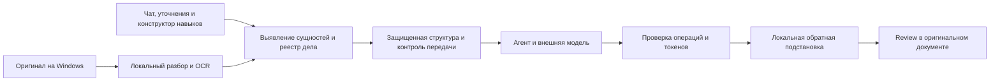

# Локальная псевдонимизация юридического контекста

Дата: 2026-10-19. Статус: обязательное направление владельца; проектирование, не реализация.
Связь: [vision](legal-ide-vision.md). Платформа первой версии — Windows.

## Цель и границы

Юрист работает с оригиналами, агент — с защищенным представлением. Имена, названия и
идентифицирующие сведения заменяются устойчивыми обозначениями; оригинальные значения
возвращаются только локально при показе результата и применении проверенной правки.

Это обратимая псевдонимизация, не доказательство полной анонимности. Публичную закупку можно
узнать по номеру, URL, точной цитате ТЗ или комбинации фактов. Поэтому продукт не должен
обещать невозможность реидентификации лишь на основании замены ФИО/реквизитов.
Терминологическое различие описывает [ICO](https://ico.org.uk/for-organisations/uk-gdpr-guidance-and-resources/data-sharing/anonymisation/pseudonymisation);
это не заключение о соответствии российского продукта требованиям закона.

## Путь данных

Оригинал, реестр и привилегированный исполнитель не являются инструментами свободного доступа
агента. Модель получает защищенные блоки с непрозрачными идентификаторами, а не исходный файл.
Все результаты чтения/поиска, история и повторные запросы также используют защищенный контекст.
Локально показанный ответ с восстановленными именами не возвращается в историю модели.
Сообщения юриста, ответы на уточнения, инструкции и образцы для генератора навыков проходят
тот же локальный разбор до первого вызова модели. Защита не зависит от наличия вложенного файла.

Материал из базы образцов организации перед выдачей заново очищается и привязывается к текущей
задаче. Токены и реестр исходного дела не переносятся; субъект референсного документа не становится
стороной текущей сделки автоматически. Допустимый образец использует параметры ролей вместо
сущностей прежнего клиента. Локальный доступ к оригиналу также ограничен правами пользователя.

## Обработка сущностей

- Один реестр на дело в пределах организации; разные дела не разделяют глобальные токены.
- Сохранять связи полного/краткого названия, реквизитов, роли и вариантов написания. Совпадение
  фамилии не означает совпадения человека; неоднозначные связи подтверждаются локально.
- Модель видит, например, `ORG_A` и отдельную роль «поставщик», `ORG_B` и «заказчик».
  Реальные значения, номера счетов, контакты и таблица замен не отправляются ей.
- В рабочем протоколе использовать типизированные ссылки на сущности с областью действия задачи,
  а не доверять любой строке вида `ORG_A`. Буквальный текст и entity reference различаются.
- Имена, ИНН/ОГРН, счета, адреса, контакты, подписи, домены, IP, внутренние системы и номера
  закупок входят в проверяемые категории. Списки распознавания расширяемы под компанию.
- Даты, суммы, статусы сторон и технические параметры могут определять правовой вывод.
  Нельзя незаметно заменить их случайными значениями. Для закрытых значений использовать
  локальные вычисления/разрешенные производные признаки либо обозначать невозможность анализа.
  Политика этих полей согласуется отдельно; это не разрешение отправлять их по умолчанию.

## Каналы и слои

Разбор и OCR исходников выполняются локально. Внешним LLM, embeddings и сервисам не передаются
оригинальные страницы, файлы или скриншоты. Для первой версии внешний контекст — только
разрешенная структурная проекция; отправка изображений потребует отдельной проверенной обработки.

Проверять DOCX-текст, таблицы, сноски, колонтитулы, комментарии, авторов и удаленный текст revisions,
гиперссылки и metadata. У PDF учитывать OCR/скрытый текст, формы, аннотации и вложения;
неизвестные слои не пересылать. Имена файлов/путей, исключения, логи и диагностика тоже могут раскрывать данные.

Правовой поиск не должен обходить защиту: общие нормы запрашиваются без идентификаторов клиента.
Если требуется получить карточку конкретной закупки, это делает отдельный локальный коннектор,
который возвращает агенту только обработанный результат. Такой коннектор сам раскрывает запрос
сайту-источнику; его сетевой доступ задается отдельной политикой. Полученные правовые/судебные
материалы также проверяются перед моделью на раскрытие участников дела.
Сырой URL идентифицирующей карточки доступен юристу локально, агенту — непрозрачная ссылка.

Если обработка не завершена, есть непроверенные слои или существенная неопределенность,
блокировать передачу и показать причину. Предусмотреть локальный просмотр защищенной версии
и исправление пропущенных/лишних замен перед первым запуском по делу.

## Применение и восстановление

Операция привязана к версии защищенного представления, версии реестра, блоку и ожидаемому тексту.
Локальный исполнитель сопоставляет ее с версией оригинала; смещения символов после замены
не используются как единственная привязка. Проверять конфликт с ручной правкой и внешним Word.

Восстановление разрешено только для известных сущностей, доступных текущей задаче.
Неизвестный/искаженный токен, запрос сущности другого дела или изменение ее роли блокируют
автоматическое применение. Модель не создает соответствия с реальными именами.
Падежи, полное/краткое название и согласование слов восстанавливаются локально; неоднозначность
отдается на review. Подстановка в правовую цитату не должна изменять оригинальный источник.

После восстановления показать фактическое было/стало, проверить роли сторон, числа, ссылки,
структуру и форматирование. Версия документа и реестр должны восстанавливаться согласованно.
Удаление/перенос дела и резервная копия должны включать политику реестра, индексов и snapshots.

## Компоненты и приемка

Кандидат для обнаружения сущностей — Presidio с локальной языковой моделью и собственными
правилами для российских реквизитов, организаций и контекста IT/закупок. Это не готовая гарантия:
проект прямо указывает, что автоматическое обнаружение может пропускать чувствительные данные.
[Документация Presidio](https://presidio.dataprivacystack.org/).

Реестр хранится зашифрованным отдельно от передаваемой проекции. Для ключа на Windows
рассмотреть DPAPI с привязкой к пользователю; перенос на другой компьютер требует отдельного
механизма восстановления. Это не защита от всех процессов в уже скомпрометированной учетной записи.
[Microsoft DPAPI](https://learn.microsoft.com/en-us/windows/win32/api/dpapi/nf-dpapi-cryptprotectdata).

Обязательные испытания перед подключением пользовательских документов:

1. Все запрещенные значения тестового корпуса, включая hidden/revision/OCR слои, отсутствуют
   в перехваченном исходящем содержимом, служебных ошибках и истории агента.
2. Одна сущность согласованна во всех файлах; однофамильцы не слиты; чужое дело недоступно.
3. Точная обратная подстановка на синтетическом наборе; атаки чужими/выдуманными токенами блокируются.
4. Привязка правки, роли сторон и review сохраняются после изменения длины и падежа названия.
5. Публичная закупка не раскрывается агенту через ссылку, поисковый запрос или ответ инструмента.
6. Изменение скрытой суммы/даты, влияющее на анализ, меняет разрешенный контекст либо ограничивает вывод.
7. Сбой, отмена и перезапуск не смешивают версии файла и реестра; восстановленный UI не утекает в prompt.
8. Оригинальное имя/номер закупки в чате или инструкции нового навыка не попадает в вызов модели.
9. Два дела с разными `ORG_A` при поиске образца не смешивают стороны и не раскрывают реестр друг друга.

Ноль утечек на контрольном корпусе — критерий теста, а не доказательство безопасности любого файла.
Качество обнаружения оценивать отдельно по типам данных, форматам и влиянию на полезность анализа.
