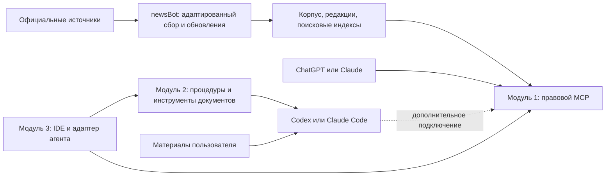

# Модульный юридический сервис

Обновлено: 2026-10-31. Статус: концепция и три раунда интервью подтверждены владельцем;
технические варианты описаны для следующего этапа реализации.

## Цель

Развивать сервис последовательно: правовой MCP, плагин юридического помощника,
затем IDE, которая подключает эти и другие модули. MCP и плагин имеют собственные
выпуски и сценарии использования без IDE и друг без друга.

## Подтверждённые границы

| Модуль | Назначение | Самостоятельное использование |
| --- | --- | --- |
| Правовой MCP | Поиск по законодательству РФ, получение содержания норм, RAG, отслеживание изменений и актуализация | Общий сервер, подключаемый к ChatGPT и Claude |
| Плагин юридического помощника | Сбор обстоятельств, подготовка и проверка документов, повторяемые процедуры | Устанавливается в Codex или Claude Code; работает с материалами пользователя без нашего MCP |
| Юридическая IDE | Рабочее пространство, документы, проверяемые правки и подключение модулей | Следующий продуктовый этап после самостоятельных модулей |

Для MCP владелец выбрал широкую базу федерального законодательства РФ с последующим
углублением качества: кодексы, законы, постановления и ведомственные акты.
Региональное и муниципальное право, судебная практика относятся к расширению.
Подбор регулирования по вопросу и поиск оснований ограничений по формулировке
выполняются составными инструментами MCP. Сервер собирает нормы и связанные положения;
подключённый агент оценивает применимость. Решение: [ADR-0003](../decisions/ADR-0003-compound-legal-search.md).
Плагин при подключении MCP получает поиск и проверку норм РФ; отсутствие этого подключения
не блокирует работу с документами пользователя.

В первом выпуске база обновляется ежедневно, агенту доступен журнал изменений.
Основой сбора служит newsBot. Плагин сначала работает с файлами в обычной среде агента;
защищённый режим с псевдонимизацией разрабатывается отдельно позже.

Сервер размещается на VPS. Платные правовые источники исключены; состав команды,
тариф и бюджет инфраструктуры пока не заданы. Юристы проверят результаты позже,
поэтому технические этапы идут отдельно от юридической приёмки.

В плагине первыми идут создание и проверка договоров с DOCX. Весь набор возможностей
claude-for-legal включён в дальнейшие этапы, включая другие практики и мониторинг.
[Каталог функций](../investigations/claude-for-legal-capabilities.md) фиксирует охват
и внешние зависимости. Наш MCP необязателен для поставки плагина. Собственный
исследовательский агент отложен; платный CoCounsel из upstream исключён.

## Пользовательская ценность и проверка независимости

| Режим | Пользователь получает | Проверка |
| --- | --- | --- |
| Только MCP и обычный ChatGPT/Claude | Подборка регулирования и возможных ограничений, тексты норм, редакции, источники и обновления | Пользователь выполняет оба составных поиска без нашего плагина и IDE; применимость оценивает агент |
| Только плагин и Codex/Claude Code | Уточнение задачи, работа с материалами дела, проект документа и отчёт проверки | Наш MCP отключён; документный сценарий выполняется, ограничения правовой проверки видны |
| Плагин с MCP | Те же процедуры с получением норм и проверкой цитат через сервер | Подключение добавляет возможности; отказ сервера не портит локальные файлы |
| IDE с подключёнными модулями | Рабочее пространство и проверяемые изменения документов | Модули продолжают работать вне IDE после её установки или удаления |

Самостоятельность означает отдельную установку, версию, документацию и приёмку.
Она не исключает зависимости от выбранного пользователем агента, модели и среды
выполнения. Разработка идёт по очереди; очередь выпуска не создаёт обязательную
runtime-зависимость плагина от MCP.

## Границы данных и исполнения

Правовой корпус общий. MCP не принимает клиентские документы для общего индексирования.
Он получает аргументы инструментов, поэтому даже поисковый запрос может содержать
конфиденциальные сведения; плагин должен формулировать запрос по правовому вопросу
без ненужных реквизитов дела. Политику хранения запросов задаём отдельно от хранения
публичных источников.

Документы дела, история и стандарты пользователя принадлежат рабочему пространству
хоста. Плагин не размещает их в своём обновляемом пакете или на сервере правовой базы.
IDE использует публичный контракт MCP и адаптер процедур плагина; прямое чтение его
внутренней БД не является интеграционным контрактом.

## Требования, переходящие из прежней концепции

- Работа начинается с цели и обстоятельств, документ необязателен на входе.
- Источник, текст цитаты, редакция и применимость проверяются раздельно.
- Плагин организует отдельную проверку правовых выводов. Совпадение цитаты на сервере
  само по себе не заменяет независимую проверку рассуждения.
- Суммы и другие формальные расчёты выполняются кодом.
- Пользователь видит проект документа и изменения перед применением к оригиналу.
- Навыки можно настраивать и повторно использовать; актуальные законы не вшиваются
  в промпты как неизменяемая база.
- Принятый макет IDE сохраняется как основа третьего модуля. Windows остаётся
  прежним целевым направлением IDE; платформы её выпуска проверим на этапе этого модуля.

Обязательная псевдонимизация для первого плагина снята явным решением владельца
30.10.2026. Её [спецификация](local-pseudonymization.md) описывает будущий защищённый
режим. Правила синтетических данных в репозитории и ограничения нынешнего демо сохраняются.

## Спецификации и порядок разработки

1. [Правовой MCP](legal-mcp.md): широкий федеральный корпус, поиск, версии и обновления.
2. [Плагин](legal-agent-plugin.md): самостоятельный помощник в Codex и Claude Code.
3. [IDE](legal-ide-shell.md): подключение модулей и работа с документами.

[Дорожная карта](../plans/active/modular-platform-roadmap.md) задаёт этапы и проверки.
У каждого модуля свой выпуск. Прежние сроки общего Windows MVP к ним не применяются.
Точные оценки составляются после выбора корпуса, ресурсов и проверки подключения.

## Открытые решения

Объём истории редакций, показатель достаточного федерального покрытия, провайдер
VPS, режим доступа, правила массового получения бесплатных данных, команда и бюджет
инфраструктуры пока не определены. [Расчёт VPS](../investigations/legal-mcp-vps.md)
предлагает исходные ресурсы и замеры; конкретный тариф не выбран.
Ответы и оставшиеся вопросы: [запись интервью](../investigations/modular-platform-interview.md).

## Основа исследования

Собственный [прототип RAG](../investigations/shared-legal-rag-spike.md), DOCX-конвейер
и IDE-прототип; система обновлений и адаптеры правовых источников newsBot;
[claude-for-legal](https://github.com/anthropics/claude-for-legal).

Сравнение способов реализации и источники: [исследование](../investigations/modular-legal-platform.md).
Разделение продуктов зафиксировано в [ADR-0002](../decisions/ADR-0002-independent-legal-modules.md).

Текущие программные возможности описаны в [архитектуре](../architecture.md).
Этот документ задаёт целевое устройство сервиса и не означает, что модули уже реализованы.
